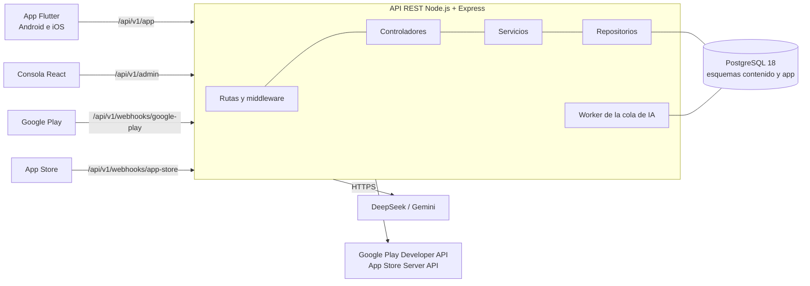

# Supera PAES

Plataforma para practicar la **PAES** (Prueba de Acceso a la Educación Superior) de Chile. Tiene una **app móvil** para estudiantes, para Android e iOS, y una **consola web** para administradores y docentes. En la consola se crean preguntas con apoyo de inteligencia artificial, y dos docentes especialistas revisan cada pregunta antes de que llegue a un estudiante.

---

## Contenido

1. [Problema y propósito](#problema-y-propósito)
2. [Qué hace el sistema](#qué-hace-el-sistema)
3. [Planes](#planes)
4. [Arquitectura](#arquitectura)
5. [Tecnologías](#tecnologías)
6. [Estructura del repositorio](#estructura-del-repositorio)
7. [Reglas de negocio principales](#reglas-de-negocio-principales)
8. [Puesta en marcha local](#puesta-en-marcha-local)
9. [Variables de entorno](#variables-de-entorno)
10. [Pruebas e integración continua](#pruebas-e-integración-continua)
11. [Despliegue](#despliegue)
12. [Forma de trabajo](#forma-de-trabajo)
13. [Planificación](#planificación)
14. [Alcance y evolución futura](#alcance-y-evolución-futura)
15. [Equipo](#equipo)

---

## Problema y propósito

La PAES define en buena parte a qué carrera y a qué universidad entra un estudiante en Chile. Prepararse bien suele costar dinero, y el proyecto apunta a tres problemas:

- **Costo.** Los estudiantes con menos recursos rara vez pueden pagar un preuniversitario o una plataforma completa.
- **Calidad del material gratuito.** Lo que hay gratis está disperso, muchas veces sin explicaciones y sin que nadie revise que las preguntas estén bien hechas.
- **Tiempo de los docentes.** Crear preguntas buenas y validadas toma mucho tiempo.

Supera PAES ofrece práctica gratuita o de bajo costo. La IA ayuda a crear preguntas rápido, y docentes especialistas garantizan su calidad.

## Qué hace el sistema

Cubre las cinco pruebas regulares de la PAES: **Competencia Lectora, Matemática M1, Matemática M2, Historia y Ciencias Sociales, y Ciencias**, según el temario DEMRE de la Admisión 2027.

### App del estudiante (Android e iOS)

- Registro con nombre, correo y contraseña, verificación de correo y recuperación de contraseña.
- Práctica mezclada, por prueba, por eje o por contenido, con corrección inmediata y explicación.
- Cupo diario de práctica e invitaciones por enlace que suman preguntas extra.
- Progreso por prueba y por eje, con los temas débiles marcados para reforzar.
- Mini-ensayos, ensayo completo y repaso de errores, según el plan.
- Suscripción mensual o anual con la facturación de Google Play o de la App Store.
- Puntajes PAES reales opcionales, descarga de datos y eliminación de la cuenta (Ley 21.719).

### Consola web (administradores y docentes)

- **Administrador:** crea, importa y genera preguntas con IA, y las envía a revisión. También publica o retira preguntas, atiende los avisos de error y gestiona usuarios internos, temario, planes, parámetros, métricas y la trazabilidad de las suscripciones.
- **Docente revisor:** revisa preguntas de su área con una pauta y les asigna dificultad. También resuelve desempates cuando el sistema se los asigna.

### Ciclo de vida de una pregunta

1. El administrador pide a la IA un lote de preguntas sobre un contenido del temario.
2. Un proceso de fondo genera las preguntas, revisa su formato y descarta las repetidas. Las válidas quedan como borrador, con una dificultad sugerida.
3. El administrador revisa el borrador y lo envía a revisión.
4. Dos docentes del área revisan la pregunta por separado, sin ver la opinión del otro ni la dificultad sugerida.
5. Si los dos aprueban, la pregunta queda aprobada. Si los dos rechazan, queda rechazada. Si alguno pide cambios, vuelve al administrador. Si uno aprueba y el otro rechaza, decide un tercer docente.
6. El administrador publica las preguntas aprobadas, y desde ese momento la app puede entregarlas.

## Planes

| Plan | Precio | Incluye |
|---|---|---|
| Gratis | $0 | Cupo diario de 10 preguntas, 20 con el correo verificado, más 5 por cada invitado que verifique su correo. Un mini-ensayo al mes por prueba y repaso de hasta 10 errores. |
| Una prueba | $1.990 al mes o $15.990 al año | Práctica y mini-ensayos sin límite en la prueba elegida. |
| Todas las pruebas | $2.990 al mes o $23.990 al año | Práctica y mini-ensayos sin límite en todas las pruebas, ensayos completos, repaso de errores y progreso detallado. |

- El plan anual cuesta lo mismo que 8 meses.
- Los precios son iguales en Google Play y en la App Store.
- Si el plan es anual, el sistema avisa por correo 7 días antes de cada renovación.
- La cancelación se hace en la gestión de suscripciones de la tienda, que la app abre directamente.
- Durante el proyecto no se cobra dinero real: las compras se prueban con las cuentas de prueba de cada tienda.

## Arquitectura

Supera PAES es un **monolito modular en capas**: una sola API REST, desplegada como una unidad y organizada por módulos funcionales. La app y la consola son sus interfaces de usuario. Se comunican con la API por HTTPS y nunca acceden directo a la base de datos.



**Módulos de la API:** cuentas, temario, preguntas, generador, revisión, práctica, cupo e invitaciones, suscripciones, privacidad y administración. Son los mismos módulos del modelo de datos.

Cada módulo tiene cuatro capas: **rutas y middleware, controladores, servicios y repositorios**. Cada capa solo usa la capa inmediatamente inferior. Un módulo usa a otro solo a través de su servicio, nunca a través de su repositorio.

**Decisiones principales**

- **Una sola API y una sola base de datos con dos esquemas** (`contenido` y `app`). Las operaciones que cruzan módulos se cumplen en una sola transacción. Por ejemplo, responder una pregunta guarda la respuesta, descuenta el cupo y actualiza el progreso de una vez.
- **Toda regla importante se aplica en el servidor.** La app nunca recibe la alternativa correcta antes de que el estudiante responda.
- **Adaptadores intercambiables** para IA, pagos y correo, elegidos por configuración. Todo se puede probar con proveedores simulados.
- **Generación con IA asíncrona.** La API registra el lote en una cola guardada en la base de datos, y un worker lo procesa por partes.
- **API sin estado** (JWT). Para crecer basta con agregar instancias iguales.
- **Formato de respuesta común:** `{ data, error, meta }`.

**Patrones aplicados:** capas, controlador, capa de servicios, repositorio, unidad de trabajo, cadena de responsabilidad (middleware), adaptador y estrategia, fábrica, productor-consumidor y receptor idempotente para los avisos de las tiendas. Los estados de las preguntas y de las suscripciones se controlan con una máquina de estados.

**Modelo de datos:** 40 tablas, 69 relaciones con integridad referencial y 6 vistas, en PostgreSQL 18. La app solo lee las preguntas publicadas, a través de vistas que no exponen la alternativa correcta.

El detalle completo está en el Documento de Arquitectura de Software (DAS), que describe el sistema con el modelo de vistas 4+1.

## Tecnologías

| Parte | Tecnología |
|---|---|
| App del estudiante | Flutter (un solo código para Android 8 o superior e iOS) |
| Consola web | React, Vite y TypeScript |
| API | Node.js 24, Express y TypeScript; SQL parametrizado con `pg`, sin ORM; validación con zod |
| Base de datos | PostgreSQL 18 |
| IA | DeepSeek (`deepseek-chat`), Gemini como respaldo y un proveedor simulado para desarrollo |
| Pagos | Google Play Billing y compra integrada de la App Store (StoreKit), más un proveedor simulado |
| Correo | Consola de la API en desarrollo, o Mailpit (opcional) |
| Pruebas | Vitest y Supertest (API), Vitest (consola), `flutter test` (app), k6 (carga), OWASP ZAP (seguridad) |
| Calidad de código | ESLint, Prettier, `flutter analyze` |
| Integración continua | GitHub Actions |
| Publicación | Render (API), Neon (base de datos), Vercel (consola), TestFlight y la prueba cerrada de Google Play (app) |

El proyecto no usa Docker. Cada parte se publica con el entorno propio de su plataforma.

## Estructura del repositorio

```
Capstone_2026_06_SuperaPAES/
├── api/
│   ├── modulos/       # un paquete por módulo: rutas, controlador, servicio y repositorio
│   ├── comun/         # middleware de seguridad, manejo de errores y configuración
│   ├── adaptadores/   # IA, pagos (Google Play, App Store, simulado) y correo
│   ├── trabajos/      # worker de la cola de generación con IA
│   ├── db/            # migraciones y semillas (temario PAES 2027, planes y parámetros)
│   └── pruebas/       # pruebas unitarias y de integración
├── consola/           # consola web: páginas, componentes, servicios y estado
├── app/               # proyecto Flutter, con las carpetas android e ios
├── docs/              # documentación técnica
└── .github/           # flujos de GitHub Actions y plantilla de pull request
```

La consola y la app dependen de la API solo por HTTP. Los módulos de la API pueden usar `comun`, `adaptadores` y `db`, pero esas carpetas nunca usan a los módulos.

## Reglas de negocio principales

- **Cupo.** El cupo diario es un solo contador para todos los modos de práctica: 10 preguntas al registrarse y 20 al verificar el correo. Las preguntas de una prueba cubierta por una suscripción vigente no descuentan cupo.
- **Invitaciones.** Se entregan 5 preguntas por cada invitado que verifica su correo. El bono se da una vez por invitado, se acumula y no vence. Hay un tope mensual de invitaciones premiadas.
- **Corrección en el servidor.** Solo se responde una pregunta que el sistema entregó a ese estudiante y que aún no ha sido respondida.
- **Alternativas.** Competencia Lectora, M1 e Historia usan 4 alternativas; M2 y Ciencias usan 4 o 5. Siempre hay una sola correcta.
- **Dificultad.** La IA o el autor solo la sugieren. Los docentes la asignan. La mezcla en práctica y ensayos es de 20 a 30 % fácil, 50 a 60 % media y 15 a 20 % difícil.
- **Revisión.** Dos docentes del área revisan cada pregunta. Nunca la revisan su autor ni quien pidió el lote. Solo se publica una pregunta aprobada y con dificultad asignada.
- **Refuerzo.** Un eje se marca para reforzar si el acierto del estudiante es menor a 60 %, con al menos 5 respuestas.
- **Calibración.** Con 30 o más intentos, una pregunta cuyo acierto no coincide con su dificultad vuelve a revisión docente.
- **Trazabilidad de suscripciones.** Cada cambio de estado queda registrado con su fecha y su origen: el estudiante, la tienda o el sistema. Cada aviso de las tiendas se registra una sola vez.
- **Privacidad (Ley 21.719).** El sistema pide solo los datos mínimos y registra el consentimiento. Es para personas de 14 años o más. Al borrar una cuenta, las respuestas quedan seudonimizadas.

## Puesta en marcha local

### Requisitos

- Node.js 24 y npm
- PostgreSQL 18
- Flutter (versión estable), Android Studio con un emulador de Android y, para iOS, macOS con Xcode
- Git

### Pasos

1. Clonar el repositorio e instalar las dependencias de la API y la consola (npm workspaces). El
   proyecto vive en la carpeta `SuperaPAES/`; los comandos siguientes se ejecutan desde ahí:

   ```bash
   git clone https://github.com/<organizacion>/Capstone_2026_06_SuperaPAES.git
   cd Capstone_2026_06_SuperaPAES/SuperaPAES
   npm ci
   ```

2. Crear la base de datos local:

   ```bash
   createdb supera_paes
   ```

3. Copiar los archivos de ejemplo de variables de entorno y completarlos (ver [Variables de entorno](#variables-de-entorno)):

   ```bash
   cp api/.env.example api/.env
   cp consola/.env.example consola/.env
   ```

4. Aplicar las migraciones y cargar las semillas (temario PAES 2027, planes y parámetros):

   ```bash
   npm run migrar -w api
   npm run semillas -w api
   ```

5. Levantar la API y la consola, cada una en su terminal:

   ```bash
   npm run dev -w api        # API en http://localhost:<PORT>
   npm run dev -w consola    # consola en http://localhost:5173
   ```

   Para comprobar que la API funciona, `GET /api/v1/salud/vivo` debe responder `200`.

6. Preparar la base de las pruebas con PostgreSQL, aparte de la de desarrollo. Su nombre debe
   terminar en `_test`: las pruebas se niegan a vaciar o borrar cualquier otra base.

   ```bash
   createdb supera_paes_test
   ```

   En `api/.env`, fijar `DATABASE_URL_PRUEBAS` con la misma dirección de `DATABASE_URL`, pero con
   `supera_paes_test` como nombre de la base. Después, migrarla con `npm run migrar -w api`, con
   `DATABASE_URL` igual a esa dirección solo para ese comando. Es el mismo procedimiento de la CI. En
   PowerShell:

   ```powershell
   $env:DATABASE_URL = "<la dirección de DATABASE_URL_PRUEBAS>"
   npm run migrar -w api
   Remove-Item Env:DATABASE_URL
   ```

   Con `DATABASE_URL_PRUEBAS` definida, `npm run test` también ejecuta las pruebas con PostgreSQL. Si
   PostgreSQL no está encendido, esas pruebas fallan.

7. Ejecutar la app en un emulador o en un teléfono:

   ```bash
   cd app
   flutter pub get
   flutter run --dart-define=API_URL=http://10.0.2.2:<PORT>/api/v1
   ```

   `10.0.2.2` es la dirección de tu computador vista desde el emulador de Android. En el simulador de iOS se usa `localhost`.

Con los proveedores en modo `simulado`, el sistema funciona completo sin claves externas: la IA devuelve preguntas de ejemplo, los pagos se aprueban o rechazan de forma simulada y los correos se muestran en la consola de la API.

## Variables de entorno

Nunca se suben valores reales al repositorio. Solo se versionan los archivos `.env.example`.

**API (`api/.env`)**

| Variable | Para qué sirve |
|---|---|
| `NODE_ENV`, `PORT` | Entorno de ejecución y puerto de la API |
| `DATABASE_URL`, `DATABASE_SSL` | Conexión a PostgreSQL (base de desarrollo) |
| `DATABASE_URL_PRUEBAS` | Base aparte de las pruebas con PostgreSQL; su nombre debe terminar en `_test` |
| `URL_CONSOLA` | Dirección pública de la consola, a la que enlazan los correos (su origen debe estar en `CORS_ORIGENES`) |
| `CLAVE_CODIGO_CORREO` | Clave del HMAC del código de 6 dígitos del correo de verificación; distinta de los secretos JWT |
| `CORS_ORIGENES` | Orígenes permitidos (la consola) |
| `JWT_SECRETO_APP`, `JWT_SECRETO_CONSOLA` | Firmas separadas para las sesiones de la app y de la consola |
| `PROVEEDOR_IA` | `simulado`, `deepseek` o `gemini` |
| `DEEPSEEK_API_KEY`, `GEMINI_API_KEY` | Claves de la IA; solo se piden si se elige ese proveedor |
| `PROVEEDOR_PAGOS` | `simulado` o `tiendas` |
| `GOOGLE_PLAY_*` | Paquete de la app, cuenta de servicio de la Google Play Developer API y audiencia de Pub/Sub; solo con `tiendas` |
| `APP_STORE_*` | Identificador de la app, clave de la App Store Server API y entorno (`sandbox` o `produccion`); solo con `tiendas` |
| `PROVEEDOR_CORREO` | `consola` o `smtp` |
| `SMTP_HOST`, `SMTP_PORT`, `CORREO_REMITENTE` | Datos del correo; con Mailpit, SMTP en el puerto 1025 y la interfaz web en el 8025 |

**Consola (`consola/.env`)**

| Variable | Para qué sirve |
|---|---|
| `VITE_API_URL` | Dirección de la API |

## Pruebas e integración continua

- **API:** pruebas unitarias de los servicios con las reglas de negocio, y pruebas de integración de las rutas con Vitest y Supertest sobre una base PostgreSQL de prueba. La meta es una cobertura de al menos 60 % en las reglas de negocio.
- **Consola:** Vitest. **App:** `flutter analyze` y `flutter test`.
- **Rendimiento:** k6 sobre la versión publicada. La meta es un percentil 95 menor a 500 ms con 100 usuarios simultáneos, sin errores 5xx.
- **Seguridad:** OWASP ZAP sin hallazgos altos abiertos, y `npm audit` sin vulnerabilidades altas o críticas.
- **Pagos:** el proveedor simulado se usa en desarrollo y en las pruebas automáticas. Las compras reales de prueba se hacen con cuentas de prueba de licencias en la prueba cerrada de Google Play, y con cuentas sandbox, StoreKit Testing y TestFlight en iOS.

Comandos desde `SuperaPAES/`:

```bash
npm run lint
npm run test               # con DATABASE_URL_PRUEBAS, también las pruebas con PostgreSQL
npm run build
npm run probar:bd -w api   # 249 casos del modelo de datos
```

`npm run probar:bd -w api` usa `DATABASE_URL`, no `DATABASE_URL_PRUEBAS`. Crea su propia base
temporal, ejecuta los casos y la borra al terminar. No vacía tablas de ninguna otra base, pero
tampoco tiene la protección de `_test` de las pruebas de Vitest.

En cada pull request, **GitHub Actions** instala las dependencias, levanta una base PostgreSQL 18 temporal, ejecuta las pruebas de la API, la consola y la app, y verifica que todo compile. Un pull request con la revisión automática en rojo no se une.

## Despliegue

| Parte | Plataforma | Configuración |
|---|---|---|
| Base de datos | Neon | PostgreSQL 18 con los esquemas `contenido` y `app`, con recuperación ante fallos activa |
| API y worker | Render (Web Service, entorno Node) | Build: `npm ci && npm run build -w api`. Pre-deploy: `npm run migrar:produccion -w api`. Start: `npm start -w api`. Ruta de salud: `/api/v1/salud/vivo` |
| Consola | Vercel | Archivos estáticos generados por Vite, con `VITE_API_URL` apuntando a la API |
| App Android | Google Play Console | Se compila con Android Studio y se distribuye por la prueba cerrada |
| App iOS | App Store Connect | Se compila y firma con Xcode en macOS y se distribuye por TestFlight |

Render y Vercel publican automáticamente la rama principal. La app lleva el mismo número de versión en Android y en iOS, y cada subida a los canales de prueba suma un número de compilación (por ejemplo, `0.7.0+3`).

Los avisos de las tiendas llegan a la API así:

- **Google Play:** notificaciones en tiempo real para desarrolladores, enviadas por Cloud Pub/Sub a `/api/v1/webhooks/google-play`. La API comprueba el token del envío y consulta el estado real de la compra en la Google Play Developer API.
- **App Store:** App Store Server Notifications V2, firmadas en formato JWS, enviadas a `/api/v1/webhooks/app-store`. La API verifica la firma con la cadena de certificados de Apple y confirma la transacción con la App Store Server API.

## Forma de trabajo

- **Ramas:** la rama principal siempre está estable y es la que se publica. Cada tarea se trabaja en su propia rama.
- **Pull requests:** los cambios entran solo por pull request, revisado por otro integrante y con la revisión automática en verde.
- **Versiones del código:** se usa versionamiento semántico `x.y.z`. Al cierre de cada sprint de desarrollo se crea una etiqueta en la rama principal (por ejemplo, `v0.4.0` al cerrar el Sprint 4), y la entrega final es `v1.0.0`.
- **Base de datos:** los cambios se aplican con migraciones ordenadas en `api/db`. El modelo y su script SQL comparten la misma numeración de versión.
- **Metodología:** Scrum, con 9 sprints semanales de 52 horas de trabajo cada uno.

## Planificación

Proyecto del 03/09/2026 al 05/11/2026.

| Sprint | Fechas | Objetivo |
|---|---|---|
| 1 | 03/09 al 09/09 | Planificación del proyecto |
| 2 | 10/09 al 16/09 | Análisis |
| 3 | 17/09 al 24/09 | Diseño |
| 4 | 25/09 al 01/10 | Cuentas y datos base |
| 5 | 02/10 al 08/10 | Banco de preguntas y generador |
| 6 | 09/10 al 15/10 | Revisión docente y calidad de la IA |
| 7 | 16/10 al 22/10 | Núcleo de la app del estudiante |
| 8 | 23/10 al 29/10 | Invitaciones, suscripción y ensayos |
| 9 | 30/10 al 05/11 | Pruebas y entrega |

**Hitos**

| Hito | Fecha | Qué debe estar logrado |
|---|---|---|
| H1 | 09/09 | Planificación aprobada |
| H2 | 16/09 | Análisis terminado |
| H3 | 24/09 | Diseño terminado; comienza el desarrollo |
| H4 | 15/10 | Una pregunta generada por la IA es revisada por dos docentes, recibe su dificultad y se publica |
| H5 | 29/10 | Demo completa: práctica, progreso, invitaciones, suscripción y su trazabilidad en la consola, con la app en un iPhone y en un Android |
| H6 | 05/11 | Entrega final: versión final de la app en la prueba cerrada de Google Play y en TestFlight, y sistema publicado |

## Alcance y evolución futura

**Fuera del alcance de esta versión:** el módulo Técnico Profesional de Ciencias, otros exámenes o países, la emisión de boletas, los cobros reales y la publicación abierta de la app en las tiendas.

**Evolución futura:** una plataforma web que reemplace a la consola. Allí el estudiante entraría con la misma cuenta de la app, y el equipo interno tendría su vista de administración. Esa plataforma integraría Mercado Pago para contratar los planes fuera de las tiendas, y permitiría descargar en PDF el repaso de errores. Sería otra interfaz de usuario sobre la misma API. El primer módulo candidato a separarse del monolito es la generación con IA.

## Equipo

| Rol | Personas |
|---|---|
| Cliente | Aprueba |
| Product Owner | Sebastián Pérez, representante de Aprueba |
| Scrum Master | Nicolas Aguayo |
| Equipo de desarrollo | Nicolas Aguayo, Catalina Lagos y Sebastian Medina |

Proyecto APT, Duoc UC, 2026.
