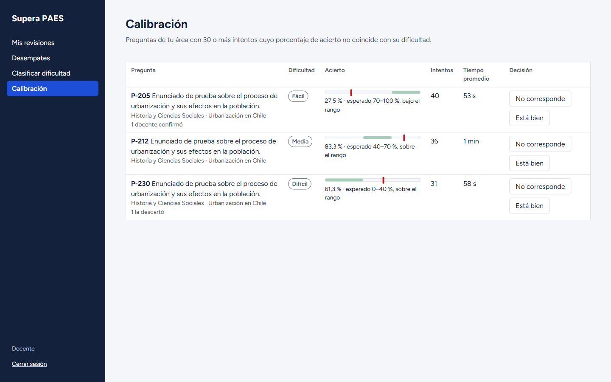
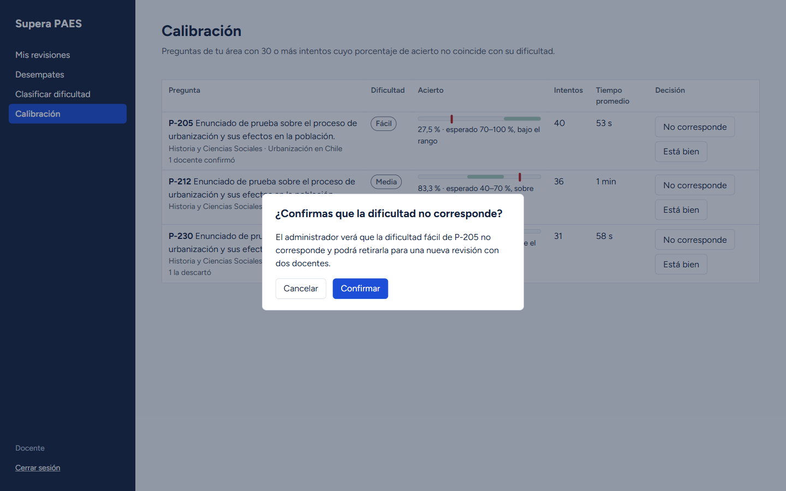
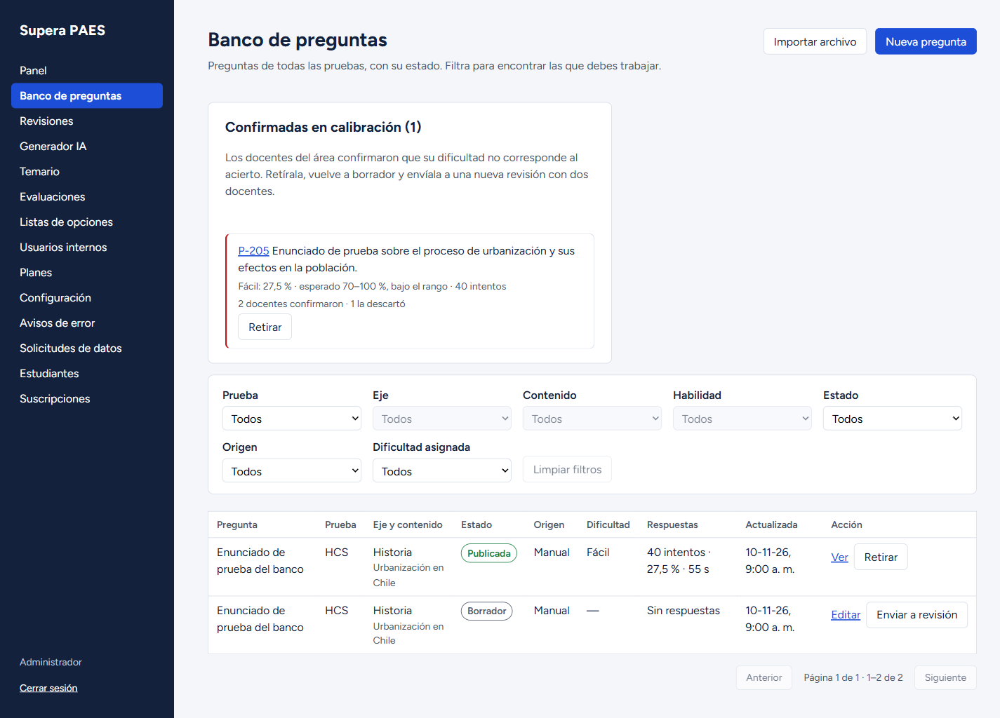
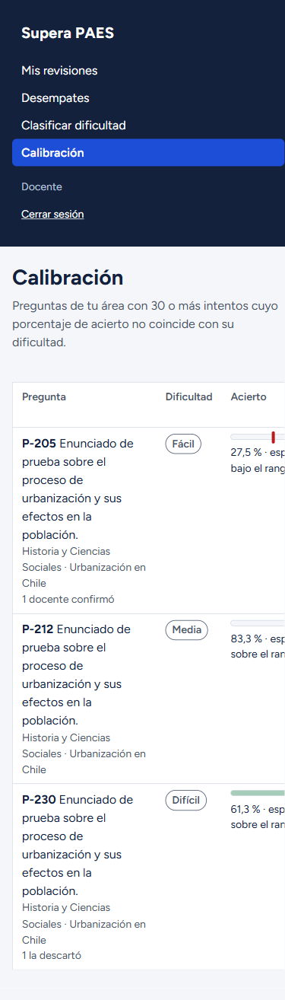
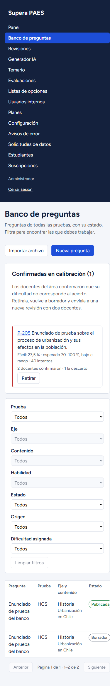

# Calibración de la dificultad (D04, HU-26 y HU-53)

Construye la última pantalla pendiente de la consola. Las estadísticas por pregunta (HU-53.1, RF-G13) se
recalculan en la tarea periódica. El docente revisa en su bandeja las preguntas cuyo acierto no coincide con
su dificultad y decide sobre cada una (HU-26.1, RN-15). El administrador ve en el banco las confirmadas y
las retira para una nueva revisión con dos docentes (HU-26.2, RF-G09, RN-10). HU-26 y HU-53 siguen
«Pendiente» en el 04: el equipo debe registrarlas en el 04 y en el Sprint Backlog vigente, con HU-53.1,
HU-26.1, HU-26.2 y HU-26.3. Plan y decisiones D1 a D7 en `docs/planes/hu-26-calibracion.md`.

## Modelo

Migración `008_calibracion.sql`, aprobada por Nicolas (D3, opción A). Solo agrega cosas; ninguna tabla
existente cambia:

- `contenido.calibracion_pregunta` (módulo `revision`): la decisión de cada docente sobre una pregunta, con
  la versión, la dificultad, los intentos y los aciertos del momento. Es única por pregunta, versión,
  dificultad y docente, y no se modifica ni se borra (`tg_solo_agregar`).
- Acciones de auditoría `confirmar_calibracion` y `descartar_calibracion`.
- `probar:bd` suma el grupo 25 (274 de 274). La base queda con 87 tablas y 162 claves foráneas.

## Contrato

Respuesta `{ data, error, meta }`. Todas las rutas usan el JWT de la consola.

| Método y ruta | Rol | Entrada | data de éxito | Errores |
| --- | --- | --- | --- | --- |
| GET /api/v1/admin/revision/calibracion | docente | Sin cuerpo | Las publicadas del área del docente con 30 o más intentos y el acierto fuera de su rango, que él no decidió para su versión y dificultad: `preguntaId`, `enunciado`, `prueba`, `contenido`, `dificultad { codigo, nombre, aciertoEsperadoMin, aciertoEsperadoMax }`, `intentos`, `aciertos`, `porcentajeAcierto`, `tiempoPromedioSeg`, `confirmaciones`, `descartes`; `meta: { total }` | 401, 403 |
| POST /api/v1/admin/revision/calibracion/:id | docente | `{ dificultadCorresponde: boolean }` (false confirma que no corresponde; true la descarta) | `{ preguntaId, dificultadCorresponde, creadoEn }` (201), con la auditoría en la misma transacción | 400 VALIDACION, 401, 403, 404 NO_ENCONTRADO (no está en su bandeja: otra área, menos de 30 intentos, dentro del rango, no publicada), 409 CONFLICTO (ya decidió esa versión y dificultad) |
| GET /api/v1/admin/revision/calibracion/confirmadas | admin | Sin cuerpo | Las publicadas con alguna confirmación para su versión y dificultad actuales, la más antigua primero, con sus estadísticas y `confirmadaEn`; `meta: { total }` | 401, 403 |
| GET /api/v1/admin/evaluaciones/estadisticas | admin | Consulta `preguntas`: hasta 100 ids separados por comas | `[{ preguntaId, intentos, aciertos, porcentajeAcierto, tiempoPromedioSeg, actualizadoEn }]`; una pregunta sin respuestas no aparece | 400, 401, 403 |
| POST /api/v1/tareas/periodicas | clave de tareas | Sin cuerpo | Suma `estadisticasActualizadas`: cuántas filas de `app.estadistica_pregunta` cambiaron | 401 |

Retirar, volver a borrador y enviar a revisión usan las rutas que ya existían
(`POST /admin/preguntas/:id/retirar`, `/:id/borrador` y `POST /admin/revision/preguntas/:id`).

Ejemplo de `GET /api/v1/admin/revision/calibracion` (datos ficticios):

```json
{
  "data": [
    {
      "preguntaId": "205",
      "enunciado": "Enunciado de prueba sobre el proceso de urbanización.",
      "prueba": "Historia y Ciencias Sociales",
      "contenido": "Urbanización en Chile",
      "dificultad": { "codigo": "facil", "nombre": "Fácil", "aciertoEsperadoMin": 70, "aciertoEsperadoMax": 100 },
      "intentos": 40,
      "aciertos": 11,
      "porcentajeAcierto": 27.5,
      "tiempoPromedioSeg": 55,
      "confirmaciones": 1,
      "descartes": 0
    }
  ],
  "error": null,
  "meta": { "total": 1 }
}
```

## Reglas

- Las estadísticas se recalculan todas juntas al final de la tarea horaria (D1). Es idempotente: solo
  escribe las filas que cambian.
- Cuentan las respuestas de `app.v_respuesta_valida` (el criterio del progreso) que el estudiante
  respondió, sobre la versión actual de la pregunta (D2). No cuentan las omitidas, las anuladas ni las de
  evaluaciones abiertas. Una pregunta que se queda sin respuestas válidas vuelve a cero.
- Entran a la bandeja las publicadas con 30 o más intentos cuyo acierto queda fuera de
  `[acierto_esperado_min, acierto_esperado_max]`. Los extremos cuentan dentro: con 70 % no sale ni de
  fácil ni de media.
- Basta una confirmación para que el administrador la vea, junto a cuántos confirmaron y cuántos la
  descartaron (D4). Un descarte la saca solo de la bandeja de quien la descartó (D5).
- Una confirmación está pendiente mientras la pregunta siga publicada con la misma versión y dificultad.
  Al retirarla deja de estarlo sola, sin columna de «atendida».
- `revision` lee las estadísticas por el servicio de `evaluaciones`, que ahora se crea antes que
  `revision` en `app.ts`.

## Pruebas

- API sin base: `tareas-periodicas.test.ts` (orden y resultado de la tarea) y `revision-calibracion.test.ts`
  (bandeja, decisión, 400, 403, 404, 409 y confirmadas). El inventario de rutas suma las cuatro nuevas.
- API con PostgreSQL: `estadisticas-pregunta-bd.test.ts` (qué cuenta, idempotencia, anulada en cero y la
  tarea) y `revision-calibracion-bd.test.ts` (umbral, borde del rango, área, guardado con auditoría, 409,
  404, descarte, confirmadas, y retiro con nueva ronda de dos revisores). `imagenes-migracion-bd.test.ts`
  actualiza el conteo de tablas y claves.
- Consola: `PaginaCalibracion.test.tsx` (carga, error con reintento, vacío, acierto y rango en texto, barra
  decorativa, confirmación, Escape y llamadas a la API) y `CalibracionBanco.test.tsx` (confirmadas con
  Retirar y la columna Respuestas).

## Consola

- **D04** reemplaza `EnConstruccion`: tabla con la pregunta, la dificultad, el acierto (barra con el rango
  sombreado y la marca del valor real, siempre con el texto al lado), los intentos, el tiempo promedio y
  cuántos decidieron. «No corresponde» y «Está bien» abren una confirmación (`alertdialog`); Escape la
  cierra y el foco vuelve al botón que la abrió. En pantallas táctiles, los botones miden 44 px.
- **C02**: arriba, «Confirmadas en calibración (N)» con Retirar; si no hay ninguna, no aparece. La tabla
  suma la columna «Respuestas» (intentos, acierto y tiempo).
- Como D04 era la última pantalla pendiente, `componentes/EnConstruccion.tsx` quedó sin uso y se quitó.

| D04 a 1440 px | Confirmación | C02 a 1440 px |
| --- | --- | --- |
|  |  |  |

| D04 a 390 px | C02 a 390 px |
| --- | --- |
|  |  |

Capturas tomadas con la API simulada y datos ficticios. La consola todavía no tiene tema oscuro.

## Verificación

Desde `SuperaPAES/`, con `main` fusionada (HU-25, PR #136):

- `npm run lint`: sin errores en el código. Prettier solo marca `consola/.impeccable/hook.cache.json`, un
  caché local excluido de git que no llega a la CI.
- `npm run test`: API 1209 pasan y 884 se omiten sin base; consola 459 pasan.
- `npm run build`, Knip, Madge, jscpd y secretlint: sin problemas.
- `npm run probar:bd`: 274 de 274.

## Pendiente para el equipo

- Registrar HU-26 y HU-53 en el 04 y en el Sprint Backlog vigente (HU-53.1, HU-26.1, HU-26.2 y HU-26.3).
- DAS: agregar `calibracion_pregunta` y las dos acciones de auditoría al modelo de datos (4.4), y la
  migración 008 al script de `docs/base-de-datos/`.
- DAS: dejar escritas las decisiones D1 (tarea horaria), D2 (qué respuestas cuentan), D4 (basta un docente)
  y D5 (el descarte es por docente) en RN-15, RF-G13 y en las tareas periódicas de 4.3.5. Agregar a CU-19
  un curso alternativo para la calibración, que hoy solo aparece en sus referencias.
- DAS 7.3 (C02): el filtro de confirmadas quedó como una sección propia sobre la tabla, con rutas de
  `revision` y `evaluaciones` en vez de un filtro de la ruta del banco.
