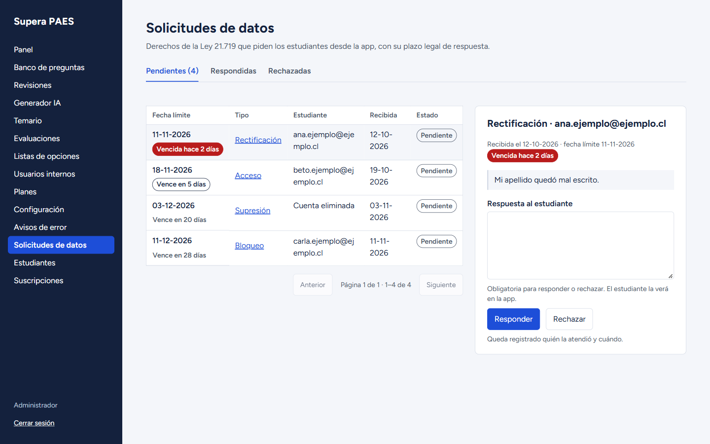
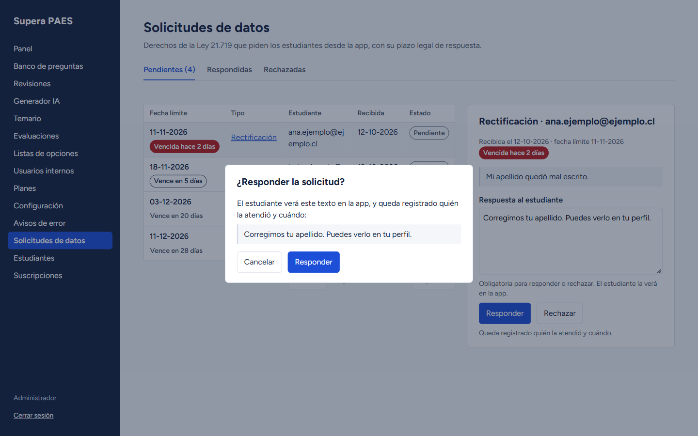
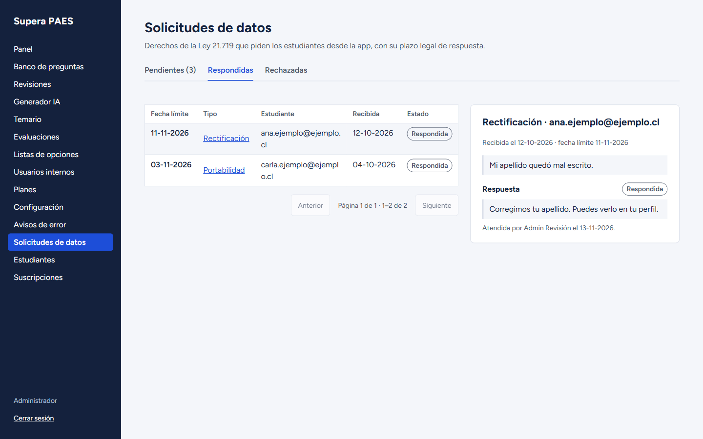
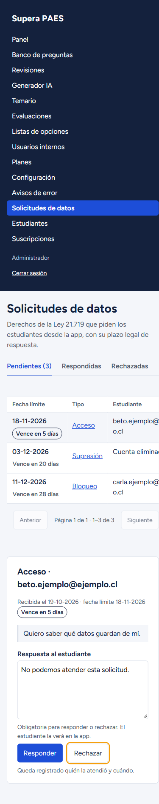

# Solicitudes de datos (C14, HU-55, con el servidor de HU-09)

Construye las solicitudes sobre los datos personales de la Ley 21.719: la app las crea y las consulta
(HU-09.1, RF-A21, CU-14 3.b) y la consola las atiende (HU-55.1, RF-C10, C14). HU-09 y HU-55 siguen
«Pendiente» en el 04: el equipo debe registrarlas en el 04 y en el Sprint Backlog vigente, con HU-09.1,
HU-55.1 y HU-55.2. La pantalla A40 de la app (Flutter) sigue pendiente. Plan y decisiones D1 a D9 en
`docs/planes/hu-55-solicitudes-datos.md`.

## Contrato

Respuesta `{ data, error, meta }`. Las rutas de la app usan el JWT de la app; las de la consola, el de
la consola con el rol admin. Un token nunca sirve en la otra interfaz (401).

| Método y ruta | Entrada | data de éxito | Errores |
| --- | --- | --- | --- |
| GET /api/v1/app/privacidad/tipos-derecho | Sin cuerpo | Lista `{ codigo, nombre, descripcion }` de los seis derechos | 401 |
| POST /api/v1/app/privacidad/solicitudes | `{ tipo: <código>, detalle?: texto de hasta 2.000 }` | La solicitud creada, pendiente, con `solicitadoEn` y `venceEn` (201) | 400 VALIDACION (tipo inexistente, detalle largo, campo desconocido), 401 |
| GET /api/v1/app/privacidad/solicitudes | Sin cuerpo | Las propias, la más reciente primero, con `estado`, `respondidoEn` y `respuesta` | 401 |
| GET /api/v1/admin/privacidad/solicitudes | Consulta `estado` (pendiente por defecto, respondida o rechazada), `pagina`, `porPagina` (20, hasta 100) | `{ solicitudes, pendientes }`; `meta` con la paginación | 400, 401, 403 |
| GET /api/v1/admin/privacidad/solicitudes/:id | Sin cuerpo | La solicitud | 400, 401, 403, 404 |
| PATCH /api/v1/admin/privacidad/solicitudes/:id | `{ estado: "respondida" \| "rechazada", respuesta: texto de 1 a 2.000 }` | La solicitud atendida | 400, 401, 403, 404, 409 CONFLICTO si ya estaba atendida |

Ejemplo de `GET /api/v1/admin/privacidad/solicitudes` (datos ficticios):

```json
{
  "data": {
    "solicitudes": [
      {
        "id": 31,
        "tipo": { "codigo": "rectificacion", "nombre": "Rectificación" },
        "detalle": "Mi nombre quedó mal escrito.",
        "estado": { "codigo": "pendiente", "nombre": "Pendiente" },
        "solicitadoEn": "2026-10-11T15:00:00.000Z",
        "venceEn": "2026-11-10T15:00:00.000Z",
        "diasRestantes": -2,
        "vencida": true,
        "respondidoEn": null,
        "respuesta": null,
        "atendidoPor": null,
        "estudiante": {
          "id": 84,
          "nombre": "Ana Ejemplo",
          "correo": "ana@ejemplo.cl",
          "cuentaEliminada": false
        }
      }
    ],
    "pendientes": 1
  },
  "error": null,
  "meta": { "pagina": 1, "porPagina": 20, "total": 1 }
}
```

## Reglas

- `venceEn` = recepción + `plazo_derechos_dias` días corridos, leído por el servicio de
  `administracion` al recibirla: un cambio del parámetro solo rige para las nuevas.
- Detalle opcional (modelo 11.0); sin límite de solicitudes por tipo ni de envíos, porque el DAS no lo
  pide (D2, D3).
- Bandeja: pendientes por fecha límite ascendente; respondidas y rechazadas por fecha de respuesta
  descendente (D6). `diasRestantes` cuenta días de calendario de Chile; `vencida` compara con el reloj.
- Responder bloquea la fila: con dos administradores a la vez, el segundo recibe 409. Estado, texto,
  fecha, autor y la auditoría `responder_solicitud` van en una transacción; la auditoría no guarda el
  texto (D4).
- Del estudiante solo se entregan nombre y correo; una cuenta eliminada llega sin ellos y su solicitud
  se puede atender (D5, D7). La app no ve quién atendió.
- No se envía correo al responder (D1): el DAS solo pide mostrar la respuesta en la app, aunque la
  política de privacidad (§3) menciona correos con las respuestas. El equipo debe alinear los textos.

## Pruebas

- `pruebas/solicitudes-derechos.test.ts` y `pruebas/solicitudes-consola.test.ts`: sin base.
- `pruebas/solicitudes-derechos-bd.test.ts` y `pruebas/solicitudes-consola-bd.test.ts`: con
  PostgreSQL (`DATABASE_URL_PRUEBAS`): plazo desde el parámetro, solo las propias, orden, vencidas,
  respuesta con auditoría, reversión si la auditoría falla, concurrencia y cuenta eliminada.
- Inventarios de ids (`comun/ids-respuesta.ts`, `pruebas/inventario-ids.ts`) y de rutas admin.

## Consola (C14)

`/solicitudes-datos`, solo administrador (HU-55.2). Pestañas Pendientes (con su total), Respondidas
y Rechazadas; tabla con fecha límite, tipo, estudiante (o «Cuenta eliminada»), fecha de recepción y
estado, con paginación. La etiqueta de plazo siempre tiene texto y una forma distinta por caso: vencida
(«Vencida hace 2 días», relleno de error), vence pronto (7 días o menos, «Vence en 5 días», borde) y a
tiempo (solo texto). El detalle va en un panel lateral, como C13 (debajo de la tabla en pantallas
angostas): qué pidió, fechas y, si está pendiente, la respuesta obligatoria con Responder y Rechazar.
Sin texto, el error queda junto al campo (`aria-invalid`, `aria-describedby`) y no se abre la
confirmación. La confirmación repite la acción y el texto, retiene el foco, se cierra con Escape y
devuelve el foco al botón que la abrió. Una solicitud atendida muestra la respuesta, quién y cuándo, sin
formulario. Estados de carga, error con Reintentar y vacío («No hay solicitudes pendientes.»).

Revisión en el navegador con la API local sobre una base temporal (migraciones, semillas y datos
ficticios; la base se borró al terminar): 1440 y 390 px sin desplazamiento horizontal de la página (la
tabla se desplaza dentro de su región), foco visible, Tab retenido en la confirmación, Escape devuelve
el foco, y responder guarda y registra la auditoría.






Pendiente de la consola: el anillo de foco global (`--foco`) sigue en ámbar, como en toda la consola,
hasta integrar el rediseño. jscpd marca dos repeticiones cortas con C13 (el bloque de carga y error de
la página, 13 líneas, y el fondo del diálogo en CSS, 11 líneas); unirlas exige tocar C13 y conviene
hacerlo con el rediseño.

## Pendiente para el equipo

- Registrar HU-09 y HU-55 en el 04 y en el Sprint Backlog, y sus casos de prueba en el C2.
- Escribir la ficha CU-33 en el DAS; actualizar RNF-09 y la política de privacidad (§8, cambio menor
  según RN-30) ahora que las solicitudes llegan por la app; decidir D1 (correo).
- Construir la pantalla A40 en la app.
